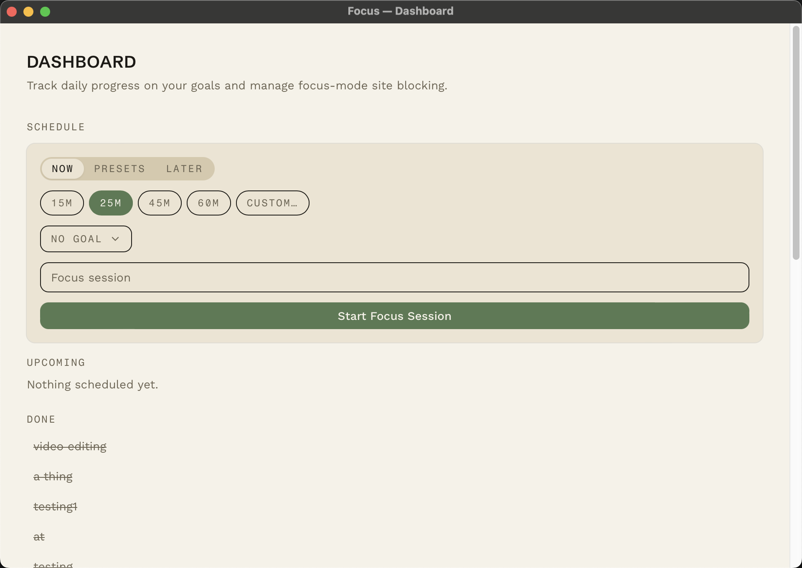
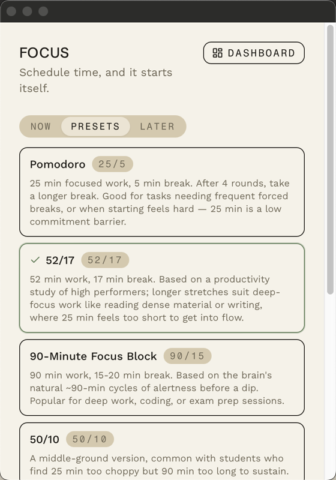

# Focus

A native macOS menu-bar app for scheduling and running focus sessions — built with **Tauri (Rust)** and **React/TypeScript**.

Schedule a block of time and it starts itself: the task auto-flips to active, fires a system notification, blocks distracting sites for the duration, and counts down live in the menu bar. No timers to remember to start, no manual "begin session" click.

<p align="center">
  
</p>

## Why this project

Most focus-timer apps make you babysit them: start the timer, remember to switch to the break, remember to start the next round. Focus is designed around a single idea — **you set the schedule once, the app owns the rest.** A background scheduler tick-checks task state every second and drives the entire session lifecycle (pending → active → completed) without any user interaction in between, including chaining work/break rounds for techniques like Pomodoro automatically.

## Features

- **Three ways to start a session** — instantly ("Now"), from a preset (Pomodoro 25/5, 52/17, 90-minute focus blocks, and more), or scheduled for later with a title, goal, and duration.
- **Auto-cycling presets, built-in or your own** — pick a study technique and the app chains work → break → work rounds back-to-back on its own, tracking round number and inserting long breaks on schedule. Don't like the built-in ratios? Save your own custom work/rest split once and it shows up as a reusable preset from then on.
- **Site blocking during focus sessions** — actively blocks configured distracting sites while a work session is running, and automatically un-blocks the moment a break starts or the session ends.
- **Recurring goals with streaks** — tag sessions against a goal (e.g. "Deep Work, 120 min/day") and track daily progress, a 7-day trend, and streaks, computed live from completed sessions.
- **Lives in the menu bar** — a single dashboard window is the one place to schedule sessions, manage goals, and configure blocked sites; the tray icon itself is context-aware, popping open a compact live-countdown view when a session is running and the full dashboard otherwise.
- **Crash-safe blocking state** — reconciles site-blocking against the database on every app launch, so a force-quit or crash mid-session can never leave sites blocked (or unblocked) incorrectly.

## Screenshots

| Dashboard | Auto-cycling presets |
|---|---|
|  |  |
| Schedule sessions, track recurring goals, and manage blocked sites — all in one window. | Pick a study technique and the app chains work/break rounds automatically. |

## Tech stack

| Layer | Technology |
|---|---|
| Desktop shell | [Tauri v2](https://tauri.app/) (Rust) |
| Frontend | React 19 + TypeScript, Vite |
| Styling | Tailwind CSS v4, Radix UI primitives |
| Backend logic | Rust — async scheduler loop, SQLite persistence via `rusqlite` |
| Persistence | SQLite (local-first; no accounts, no network sync) |

## Architecture highlights

- **Single async scheduler loop** (`scheduler.rs`) ticks every second, transitioning tasks through their lifecycle, firing OS notifications, updating the live tray-icon countdown, and toggling site blocking — all from one source of truth instead of scattering timers across the UI.
- **Two windows, one React app** — a full dashboard for scheduling and management, and a small popover that exists purely to show the live countdown while a session is active. Both render from the same codebase based on window identity, kept in sync across windows via Tauri's event system rather than a shared process. Clicking the tray icon is context-aware: it shows the countdown popover if a session is running, or opens the dashboard otherwise.
- **Auto-cycling presets are DB-driven, not catalog-driven** — the scheduler chains the next work/break round purely from columns already stored on the task row, never re-reading the preset catalog at chain time. That means a user-defined custom preset auto-cycles through exactly the same code path as a built-in one, with no special-casing.
- **Site blocking via `/etc/hosts`** — redirects blocked domains to localhost inside clearly-marked blocks, with a one-time permission grant so no repeated OS prompts interrupt a session.
- **Three-layer design token system** — a custom "Marginalia" visual identity (self-hosted fonts, a paper/ink color system, a distinct dark "stage" mode for active sessions) built on Tailwind's token layer rather than default component styling.

## Download

Focus is in early beta. Grab the latest build from [GitHub Releases](https://github.com/ederwinz/counterpart-productivity/releases/latest):

1. Download the `.dmg` (Apple Silicon Macs only for now).
2. Open it and drag **Focus.app** into **Applications**.
3. See **Gatekeeper bypass** below before you launch it the first time.

This beta build is unsigned (no Apple Developer ID yet), so macOS's Gatekeeper will refuse to open it with a normal double-click. Once launched (see below), Focus runs as a completely normal app — the one-time bypass is only needed the first time.

### Gatekeeper bypass

macOS will say *"Focus can't be opened because it is from an unidentified developer."* To get past this (only needs doing once):

- **Finder**: right-click (or Control-click) **Focus.app** → **Open** → confirm **Open** in the dialog that appears.
- **Terminal**: `xattr -cr /Applications/Focus.app`, then launch normally.

Proper code signing + notarization (which removes this warning entirely) is planned as a fast-follow.

### Feedback

Found a bug, or have a suggestion? Use the **Feedback** section in the app's dashboard to send a note directly — it's the fastest way to reach me during the beta.

## Running locally

```bash
npm install
npm run tauri dev
```

Requires Rust (`cargo`) and the Tauri v2 toolchain. See [Tauri's prerequisites guide](https://tauri.app/start/prerequisites/) for platform setup.

---

Built as a personal productivity tool and portfolio project by Edwin Zhu.
